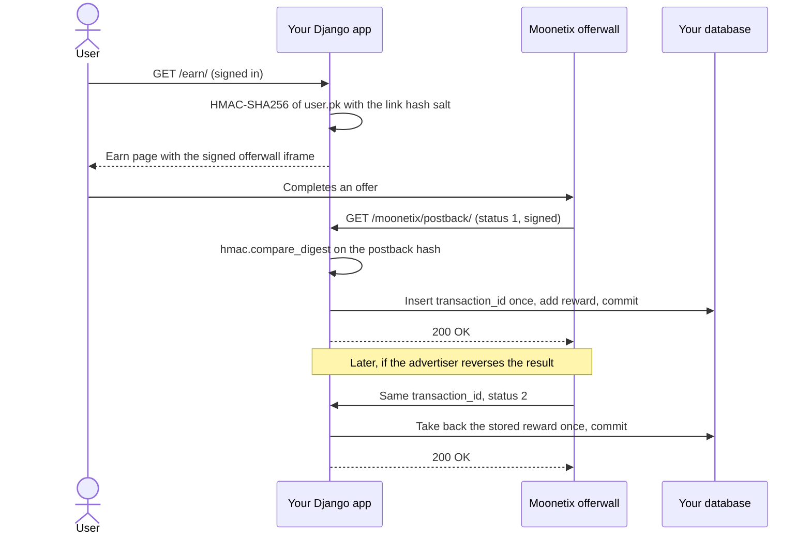

# Moonetix Offerwall for Django

**A Django 6.1 app with an Earn page and a postback view that credits every offer exactly once.**

[](https://github.com/moonetix/offerwall-django/actions/workflows/ci.yml)
[](LICENSE)
[](https://docs.moonetix.com/postbacks)
[](https://moonetix.com/register?from=github-offerwall-django)
[](https://moonetix.com/academy/integrations/offerwall-postback-python)
[](https://moonetix.com/integrations/website)

A small Django project with the [Moonetix](https://moonetix.com) offerwall. The Earn page signs the offerwall link on the server for the signed-in user. The postback view verifies the hash with `hmac.compare_digest`, credits each `transaction_id` once, and takes back only what it credited. Moonetix is an affiliate network: your users earn your own currency by completing offers, and you earn per completed offer.

> **Get your App ID and keys: sign up free at https://moonetix.com/register?from=github-offerwall-django**

## Design choices

1. **Balances that stay right.** The primary key on `transaction_id` and one `transaction.atomic` block decide every credit. Retries, duplicates and late credits after a reversal pay nothing, and a reversal takes back the stored amount from the user who got it.
2. **Tested against real postbacks.** The 27 tests replay links and postbacks produced by the Moonetix code itself, including tampered, wrongly signed and malformed requests, and a failure halfway through a credit.
3. **One reusable app.** Everything lives in the `rewards` app: a model, a migration, two views and a template. Add it to `INSTALLED_APPS` of your own project and include its URLs.

## Postback lifecycle



## Quick start

You need Python 3.12 or later.

```bash
git clone https://github.com/moonetix/offerwall-django.git
cd offerwall-django
python3 -m venv .venv && . .venv/bin/activate
pip install -r requirements.txt
cp .env.example .env              # fill in your Moonetix keys
set -a; . ./.env; set +a          # load them into your shell
python manage.py migrate
python manage.py createsuperuser  # your demo user
python manage.py runserver        # http://127.0.0.1:8000
```

Sign in at `/accounts/login/` and open `/earn/`.

| Variable | Where to find it |
| --- | --- |
| `MOONETIX_APP_ID` | Dashboard, Offerwalls, your offerwall, Integration |
| `MOONETIX_LINK_SALT` | Same place: the link hash salt. Signs offerwall links. |
| `MOONETIX_POSTBACK_KEY` | Postback page: the postback secret key. Signs postbacks. |
| `DJANGO_SECRET_KEY` | Required unless `DJANGO_DEBUG=1`. Without it the app stops with `Set DJANGO_SECRET_KEY, or DJANGO_DEBUG=1 for local development.` |
| `DJANGO_DEBUG` | Optional, default `0`. Only `1` turns debug on. |
| `DJANGO_ALLOWED_HOSTS` | Optional, default `127.0.0.1,localhost`. Comma-separated. Add your real host in production. |
| `DATABASE_PATH` | Optional, default `db.sqlite3` in the project folder. |
| `MOONETIX_LOG_LEVEL` | Optional, default `INFO`. Level of the `moonetix` logger that records every postback. |

Save this postback URL on the Postback page of your dashboard, with your real host. Keep the slash before `?`: without it, `APPEND_SLASH` answers 301 and Moonetix does not follow redirects.

```text
https://yoursite.com/moonetix/postback/?tx={transaction_id}&user={user_id}&reward={reward}&status={status}&event={event_id}&payout={payout}&offer={offer_name}&hash={hash}
```

The offerwall iframe only loads on https pages of the website you registered for the app. On `http://127.0.0.1:8000` it stays blank, which is expected. Open the signed link in a new tab instead, or test on an https staging host.

## How it works

1. `/earn/` is `@login_required` and `@never_cache`. Until the user confirms they are 16 or older, no link is built.
2. `rewards.moonetix.wall_url()` signs `str(user.pk)` with the link hash salt (HMAC-SHA256, lowercase hex) and returns `https://wall.moonetix.com/{APP_ID}?user_id=...&hash=...`. A user ID sent by the browser is never used. The template escapes the `&`, which is correct inside an HTML attribute.
3. Moonetix calls `GET /moonetix/postback/` for every credit (status 1) and reversal (status 2). The view takes each value only if it appears exactly once, as it arrived.
4. It computes the expected hash of `tx:user:reward:status` with the postback secret key and compares bytes with `hmac.compare_digest`. A mismatch gets 403. Nothing else runs before this check.
5. Test postbacks from the dashboard (`transaction_id` starting with `test_`) are verified and logged, never credited.
6. Inside `transaction.atomic`, `bulk_create(ignore_conflicts=True)` inserts the transaction row or skips it, and `select_for_update()` locks it. Only the request that inserted the row credits. Status 2 flips a credited row to reversed and subtracts the stored amount. A reversal for a transaction that was never credited is recorded, so a late credit is not paid.
7. The answer is 200 only after the commit. Any exception rolls back and Django answers 500, so Moonetix retries.

## Add it to your own project

1. Copy the `rewards` folder into your project and add `"rewards"` to `INSTALLED_APPS`.
2. Add `path("", include("rewards.urls"))` to your root `urls.py`.
3. Add the three `MOONETIX_*` lines from `config/settings.py` to your settings.
4. Run `python manage.py migrate`.
5. If your user primary keys are UUIDs, change the pattern in `_find_user_pk()` in `rewards/views.py`.

Balances live in `rewards.Wallet.balance_micro`, a signed 64-bit integer of millionths of a coin. Decimal rewards such as `0.75` and `1.23456` add up exactly, with no floating point. The demo sign-in uses Django's built-in `django.contrib.auth.urls`. Keep your own authentication.

## Security notes

- The link hash salt and the postback secret key come only from environment variables. They never reach a template. Never commit `.env`.
- The postback hash is checked first, with `hmac.compare_digest` on bytes, so a hash with unusual characters is a clean 403 instead of a `TypeError`.
- `transaction_id` is the primary key. The credit is decided by the insert, not by a read before it.
- `select_for_update()` has no effect on SQLite. SQLite still serializes the writes, but use PostgreSQL or MySQL in production, where the row lock makes two simultaneous copies of one event wait for each other.
- A reversal only flips a credited row and subtracts the amount stored with the credit. It can take a balance below zero if the user already spent the coins. Say in your terms that rewards can be taken back.
- `payout`, `event`, `offer` and the other macros are not signed. The example stores the offer name for display only.
- `@csrf_exempt` is on the postback view only, together with `@require_GET`. Never remove `CsrfViewMiddleware` to make postbacks work. Do not put the view behind `@login_required`, a redirect (http to https, missing slash) or a per-IP rate limit.
- Reward users only for completed offers. Never for sign-ups, invites, likes, reviews or other engagement. Users must be 16 or older.

## Test it locally

```bash
python manage.py test
```

```text
Ran 27 tests
OK
```

No keys needed. The fixtures in `rewards/tests/moonetix_vectors.json` were produced by the Moonetix link and postback code with fake test keys (`demoapp0000000000000001`, `test_link_salt_not_secret`, `test_postback_key_not_secret`). The tests check:

- the signed link matches the Moonetix link for four user IDs, including one that needs URL encoding;
- the Earn page redirects guests, builds no link before the age check, ignores a `user_id` in the query string, sends `no-store`, and never prints a key;
- credit, retry, decimal and large rewards, reversal, repeated reversal, credit after reversal, reversal before any credit, negative balance after a reversal, `test_` postbacks, unknown users;
- 403 for a wrong key, a changed reward, user, transaction or status, an uppercase, missing or repeated hash, and a repeated parameter; 405 for POST; 301 for a URL without the slash;
- 500 when the key is missing or storage fails, with nothing half applied, and a clean credit on the retry.

To send a signed postback by hand to `runserver`, with your key loaded and demo user 1:

```bash
TX=local_1 U=1 R=150 S=1
HASH=$(python3 -c 'import hmac,hashlib,os,sys;print(hmac.new(os.environ["MOONETIX_POSTBACK_KEY"].encode(),sys.argv[1].encode(),hashlib.sha256).hexdigest())' "$TX:$U:$R:$S")
curl -i "http://127.0.0.1:8000/moonetix/postback/?tx=$TX&user=$U&reward=$R&status=$S&hash=$HASH"
```

Run it twice: the balance goes up once. Set `S=2` and run it again: the 150 coins come back off.

For a full pass over the view, run [postback-tester](https://github.com/moonetix/postback-tester) against `runserver`. It signs requests the way Moonetix does and sends a credit and its retry, three kinds of reversal, four forged or unsigned postbacks and five parallel copies of one credit. Its transaction IDs start with `test_`, which this view verifies and logs without crediting, so the run checks the signature handling and the answers; the Django tests above cover the balances.

```bash
npx github:moonetix/postback-tester --preset moonetix \
  'http://127.0.0.1:8000/moonetix/postback/?tx={transaction_id}&user={user_id}&reward={reward}&status={status}&event={event_id}&payout={payout}&offer={offer_name}&hash={hash}' --user 1
```

## Test it with Moonetix

1. Deploy to a public https host and save the postback URL above on the Postback page.
2. Open Offerwalls, your offerwall, Integration. Under Integration status, use Check a link: type user ID `1` into Test a link and compare it with the iframe `src` on your Earn page. They must be identical.
3. Click **Send a test postback**, once with status 1 and once with status 2. The result window should show 200 and `Test postback: hash OK, nothing credited`. You can also send one from the Postback page.
4. Every attempt and your server's answer are listed under Reports, Postbacks.
5. Open the offerwall from a normal home or mobile connection. VPNs, proxies, Tor and data center networks see a block page.

## Common failures

| Reports, Postbacks shows | Cause | Fix |
| --- | --- | --- |
| `301` | The saved URL has no slash before `?`, or http redirects to https. Moonetix does not follow redirects. | Save the exact final URL: `https://yoursite.com/moonetix/postback/?...`. |
| `400` with a Django error page | The host is not in `DJANGO_ALLOWED_HOSTS`. | Add your public host name. |
| `403 Invalid hash` | Wrong key, a missing or repeated parameter, or a value changed on the way. | Use the postback secret key, not the link hash salt. Paste the logged URL into the [hash checker](https://moonetix.com/tools/postback-hash-checker). |
| `400 Bad parameters` | Signed, but `tx` is empty or over 191 characters, `reward` is not a plain number, or `status` is not 1 or 2. | Map each macro to the parameter name shown in the postback URL above. |
| `200 Unknown user, nothing credited` | The `user_id` is not a `user.pk` in this database, for example `test_user`. | Sign links with `user.pk`, or change `_find_user_pk()` if your keys are UUIDs. |
| `500` | `MOONETIX_POSTBACK_KEY` is not set (`ImproperlyConfigured`) or the database write failed. Nothing is stored, and Moonetix retries. | Set the variable in the process that runs Django, not only in your shell. |

## References

- Academy: [Offerwall postback in Python: Django and Flask](https://moonetix.com/academy/integrations/offerwall-postback-python)
- Academy: [Postback security](https://moonetix.com/academy/traffic-quality/postback-security) and [Prevent duplicate reward credits](https://moonetix.com/academy/integrations/prevent-duplicate-reward-credits)
- Academy: [How to write an earn page that converts](https://moonetix.com/academy/monetization/earn-page-that-converts)
- Moonetix for websites: [moonetix.com/integrations/website](https://moonetix.com/integrations/website) and [web apps](https://moonetix.com/industries/web-apps)
- Docs: [Offerwall link](https://docs.moonetix.com/offerwall-link), [Postbacks](https://docs.moonetix.com/postbacks), [Credits and reversals](https://docs.moonetix.com/credits-and-reversals), [Testing](https://docs.moonetix.com/testing)
- Free tools: [Offerwall link builder](https://moonetix.com/tools/offerwall-link-builder) and [Postback hash checker](https://moonetix.com/tools/postback-hash-checker)

## Start with Moonetix

**Get your App ID and keys: sign up free at https://moonetix.com/register?from=github-offerwall-django**

Every publisher application is reviewed by hand. Once you are approved, add your website as an app, set your currency name and rate, and paste the keys into `.env`.

## More Moonetix examples

| Repo | What it is |
| --- | --- |
| [awesome-offerwalls](https://github.com/moonetix/awesome-offerwalls) | Curated offerwall resources and guides |
| [offerwall-postback-handlers](https://github.com/moonetix/offerwall-postback-handlers) | Postback handlers in PHP, Node.js, Python and Java |
| [offerwall-nextjs-starter](https://github.com/moonetix/offerwall-nextjs-starter) | Next.js starter with a signed offerwall link |
| [telegram-mini-app-offerwall](https://github.com/moonetix/telegram-mini-app-offerwall) | Telegram Mini App with an offerwall |
| [discord-rewards-bot](https://github.com/moonetix/discord-rewards-bot) | Discord bot that rewards offer completions |
| [moonetix-offerwall-wordpress](https://github.com/moonetix/moonetix-offerwall-wordpress) | WordPress plugin |
| [moonetix-android-sdk](https://github.com/moonetix/moonetix-android-sdk) | Android SDK |
| [moonetix-ios-sdk](https://github.com/moonetix/moonetix-ios-sdk) | iOS SDK |
| [moonetix-flutter](https://github.com/moonetix/moonetix-flutter) | Flutter plugin |
| [moonetix-react-native](https://github.com/moonetix/moonetix-react-native) | React Native package |
| [moonetix-unity](https://github.com/moonetix/moonetix-unity) | Unity plugin |
| [offerwall-laravel](https://github.com/moonetix/offerwall-laravel) | Laravel Earn page and postback route |
| [offerwall-express](https://github.com/moonetix/offerwall-express) | Express 5 Earn page and postback route |
| [offerwall-vue-nuxt](https://github.com/moonetix/offerwall-vue-nuxt) | Nuxt Earn page and postback server route |
| [offerwall-firebase-functions](https://github.com/moonetix/offerwall-firebase-functions) | Firebase Cloud Functions backend |
| [offerwall-supabase](https://github.com/moonetix/offerwall-supabase) | Supabase Edge Functions backend |
| [offerwall-react-vite](https://github.com/moonetix/offerwall-react-vite) | React and Vite front end |
| [rewards-site-starter](https://github.com/moonetix/rewards-site-starter) | Starter for a rewards website |
| [offerwall-unity-example](https://github.com/moonetix/offerwall-unity-example) | Unity example game |
| [offerwall-godot](https://github.com/moonetix/offerwall-godot) | Godot example |
| [offerwall-html5-game](https://github.com/moonetix/offerwall-html5-game) | HTML5 web game example |
| [offerwall-flutter-example](https://github.com/moonetix/offerwall-flutter-example) | Flutter example app |
| [offerwall-react-native-example](https://github.com/moonetix/offerwall-react-native-example) | React Native example app |
| [offerwall-chrome-extension](https://github.com/moonetix/offerwall-chrome-extension) | Chrome extension example |
| [offerwall-electron](https://github.com/moonetix/offerwall-electron) | Electron desktop app example |
| [postback-tester](https://github.com/moonetix/postback-tester) | Sends signed test postbacks and catches double credits, missed reversals and forged requests |
| [signup-guard](https://github.com/moonetix/signup-guard) | Sign-up risk checks for Node.js and PHP: disposable emails, datacenter and Tor IPs |
| [datacenter-ip-ranges](https://github.com/moonetix/datacenter-ip-ranges) | Daily cloud, Tor and iCloud Private Relay IP ranges from official feeds |
| [offerwall-fraud-playbook](https://github.com/moonetix/offerwall-fraud-playbook) | Fraud playbook for offerwall and rewards publishers, with tested code |
| [reward-economy-kit](https://github.com/moonetix/reward-economy-kit) | Integer points math: payout to points, bonuses, reversals, cash-out pricing |
| [referral-engine](https://github.com/moonetix/referral-engine) | Referral codes, attribution and a clawback-safe commission ledger |
| [gamification-kit](https://github.com/moonetix/gamification-kit) | Streaks, XP levels, quests and leaderboards that survive time zones and DST |
| [affiliate-postback-macros](https://github.com/moonetix/affiliate-postback-macros) | Postback macros and signatures of tracking platforms and offerwalls |
| [country-tiers](https://github.com/moonetix/country-tiers) | Tier 1, 2 and 3 countries as JSON and CSV, with helpers in JavaScript, PHP and Python |

## License

MIT. See [LICENSE](LICENSE).
